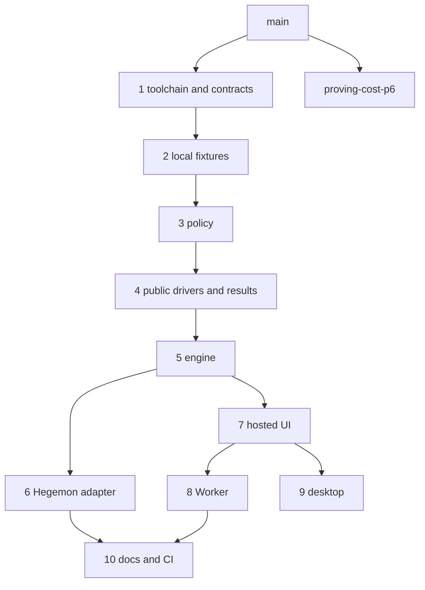

# Swap series PR split

A verified order for turning branch `local-private-spend-htlc` (plus the uncommitted P7 files) into reviewable pull requests against `main`. No branches, commits or PRs have been opened; this is the plan to apply once approved. File lists for each slice: `.agent/SWAP_PR_SPLIT_FILES.json`.

The skill default is independent PRs off `main`. That does not work here. Public drivers import `swap_engine.timelock_policy`, and engine adapters import those drivers, so the slices have to stack. Desktop and the proving-cost branch do not.

## Applied order

Each PR is the named files at their final contents, applied on top of the previous PR. Tests below were run in a worktree of `main` at `/tmp/p7-prsplit` by copying those files from the current checkout.

1. **Toolchain and contracts.** Node 24 pin (`.nvmrc`, `engines` in `swap-service` and `vendor-src` package.json), `scripts/swap_engine/tools.py` plus `__init__.py`, the Ethereum and Cardano HTLC contracts, the tool installer and the two requirements files. Why first: every later Python script locates binaries through `tools.py`. Verified: `from swap_engine.tools import find_tool` resolves `anvil`; the slice compiles.

2. **Local fixtures.** Companions, observers, `local_multichain_htlc_swap.py`, `local_private_spend_swap.py`, the `private-spend` `verify-htlc` command. Verified: the slice compiles. Heavy local-chain runs stay out of CI.

3. **Policy.** `timelock_policy.py` / `timelock-policy.mjs`, shared vectors, `config/swap/chain-timing.json` and the hosted copy `swap-ui/chain-timing.json` (the Python tests require the two files to be byte-identical), `deadlines.mjs`. Must precede the drivers because `public_bitcoin_driver.policy_limits` and `public_cardano_verify` import it. Verified: `python3 -m unittest swap_engine.test_timelock_policy` — 9 tests OK. First attempt failed until the hosted `chain-timing.json` copy was in this PR, not the UI PR.

4. **Public drivers and results.** `scripts/public_*`, the verifier, sweep tools, `PUBLIC_TESTNET_RESULTS.md`, the Hegemon public rehearsal runbook. Verified: `test_public_bitcoin_transactions`, `test_public_swap_journal`, `test_public_testnet_probe` — 11 tests OK.

5. **Engine.** The rest of `scripts/swap_engine/` (store, engine, planner, adapters for Bitcoin/Ethereum/Cardano, Hegemon stub, simulated chains, identity, flow vectors, CLI) plus `swap-ui/swap-flow.mjs` (the planner-margin mirror) and `config/swap/identity-vectors.json`. The generated SRI files stay with the UI PR. `hegemon_local.py` stays with PR 6; `local_world.py` and the CLI import it lazily. Verified: `test_store`, `test_engine`, `test_planner`, `test_adapters` — 76 tests OK; `test_identity` — 13 tests OK.

6. **Hegemon adapter.** `adapters/hegemon_local.py`, `hegemon_wallet.py`, `hegemon_fake.py`, `local_hegemon.py`, gateway check, local e2e tests. Independent of the UI. Verified on top of PRs 1–5: `test_hegemon_adapter`, `test_local_hegemon_timing`, `test_check_hegemon_gateway` — 46 tests OK. Does not touch the operator's public node.

7. **Hosted UI.** `swap-ui/` (except the policy and `swap-flow` files already landed), local relay, vendored bundles, `build_client_manifest.mjs` and the generated `index.html`, `hosted.html`, `client-manifest.json`. Every later UI edit must rebuild those generated files; reviewers should not hand-edit them. Verified on top of PRs 1–5: `timelock-policy`, `swap-flow`, `crypto`, `identity` tests — 36 tests OK.

8. **Worker.** `swap-service/cloudflare/` (`worker.mjs`, D1 schema and `0002_identity.sql`, `wrangler.jsonc`, `client-policy.mjs`, tests). After the UI because the Worker serves the manifest. Not deployed: the operator backs up D1, migrates, then deploys. Verified with the UI files present: `server.test.mjs` and `worker.test.mjs` — 17 tests OK.

9. **Desktop.** `hegemon-app/` swap-board and pre-mainnet profile plus `start.sh`. Optional after the UI. `make swap-integration` skips it with an explicit message when `hegemon-app/out/renderer/index.html` is missing.

10. **Docs and CI.** `DESIGN.md`, `METHODS.md`, `CHANGELOG.md`, `docs/SWAP_TOOLCHAIN.md`, `scripts/SWAP_SCRIPTS.md`, `Makefile` swap targets, `.github/workflows/swap-fast.yml`, the secret scanner. Last so each product PR can be reviewed without a novel. If a reviewer needs the DESIGN section next to the code, cherry-pick that hunk into the earlier PR; the file-level split was verified with docs last.

**Separate, already on its own branch:** `proving-cost-p6` (worktree `~/hegemon-proving`, commit `fe656d3c`), based on `main`, touching no consensus code.

`.agent/` ExecPlans and `.cursor/plans/` can ride with the PR they describe or go in a notes commit; they are not required for the tests above.

## What this split is not

It is not a reconstruction of git history. Several files mix concerns (`public_bitcoin_driver.py` is both the original driver and the P1 policy floor). Stacking the final files in the order above is enough for each PR to import what it needs. Hunk-splitting those mixed files is possible but was not required to get the tests green.

CI (`.github/workflows/swap-fast.yml`) belongs in PR 10. Until that lands, the earlier PRs have no swap workflow; run `make swap-test` locally after PR 5.

## Commands a reviewer of one stacked PR can run

From the repository root, Node 24, `PYTHONPATH=scripts:$HOME/.local/opt/hegemon-swap-python` (see `docs/SWAP_TOOLCHAIN.md`):

    python3 -m swap_engine.tools                  # after PR 1
    python3 -m unittest swap_engine.test_timelock_policy   # after PR 3
    python3 -m unittest discover -s scripts -t scripts -p 'test_public_*.py'  # after PR 4
    python3 -m unittest discover -s scripts/swap_engine -t scripts -p 'test_*.py'  # after PR 5 (Hegemon tests skip)
    node --test swap-ui/*.test.mjs                # after PR 7
    node --test swap-service/cloudflare/worker.test.mjs  # after PR 8
    make swap-test                                # after PR 10
