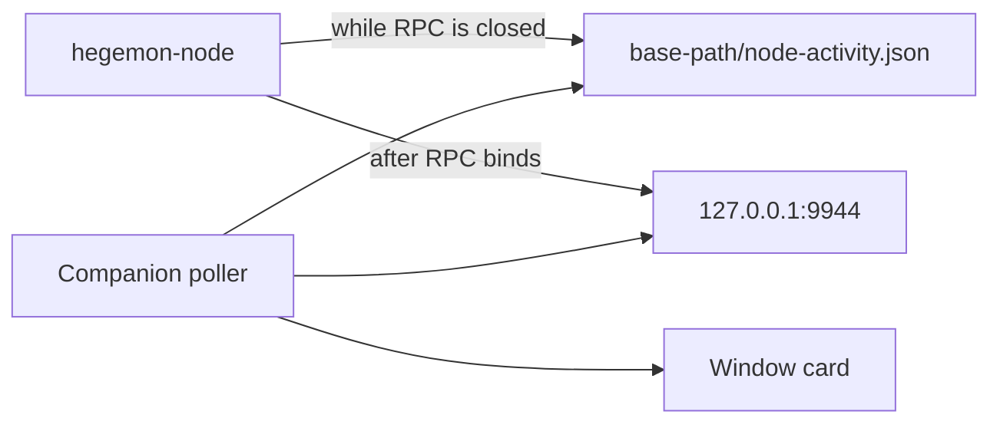

# Companion node activity

The window in [`scripts/local_swap_companion.py`](scripts/local_swap_companion.py) currently has one status sentence, and that sentence is about the wallet scan. During the restart, port 9944 stayed closed for the whole database rebuild and Poseidon2 proof replay, so the companion had nothing it could ask. The node only printed progress to its own log.

The window will get a node card at the top. Wallet unlock stays underneath and keeps its own sentence. This stays inside `--gui`. The hosted page does not receive node progress.

## What the card says

A light card (`#F4F7FB` on the existing `#0E1C36` window) at the top of the window, above the pairing token. Critical status sits in the upper left.

- A dot and a short state: **Caught up**, **Catching up**, **Rechecking private proofs**, or **Not running**.
- The fraction in monospace: `Block 14,200 of 15,818`.
- A determinate bar. Track `#E1E6EE`, fill `#1BE7FF`. This is a deliberate brand deviation from the shimmer rule, because a shimmer cannot answer "how much is done." A step with no fraction uses the neutral shimmer instead.
- One time line, updated only when the rounded value changes: `About 6 minutes left`, `Under a minute left`, or `This stretch slowed down. About 20 minutes at this pace.`
- One consequence line: `The node is not accepting connections until this finishes.` or `Ready. Height 16,427, 15 peers.`

Ionosphere means work in progress. Guard Rail means not running or stopped. "Caught up" is the words plus a full bar, so the window does not add a third accent beside the buttons and the error color.

Phases, in the order the restart actually ran:

- Opening the chain database
- Loading saved blocks
- Rebuilding chain state (fraction, from the legacy reconstruction log)
- Rechecking private proofs (fraction, from the V8 scratch replay)
- Saving the checked chain (fraction, only if the durable tip is behind)
- Checking chain indexes (no fraction)
- Starting the network
- Catching up with the network (`height` toward `sync_target_height`)
- Caught up (`syncing` false and at least one peer)

## Where the facts come from

RPC is the live source once `system_health` and `hegemon_consensusStatus` answer. The poller calls only those two methods, with a one-second timeout, from a background thread. The Tk timer only reads the latest snapshot, so a slow call cannot freeze the window. Full `probe()` is too heavy for a one-second tick.

Before RPC exists, the node writes [`{base-path}/node-activity.json`](node/src/native/node_impl.rs) beside the sled database. `start.sh` already uses `~/.hegemon-node-v0.11`. The file is a small fixed record: `phase`, `current`, `total`, `updated_at_ms`, `pid`. Writes are atomic and best-effort, on the same boundaries as today's progress logs (every 100 blocks plus each phase change). The companion maps the phase name to the sentences above and ignores any other text, so the file cannot put arbitrary copy on screen.

A dead `pid` means the node stopped. The card then says it stopped during that step, at that fraction, instead of leaving a frozen "working" bar. If the pid is alive but the file has not changed for a couple of minutes, the card says it is still on that step and shows how long since the last update. The slow proof blocks seen today were under a minute, so a quiet stretch stays visible instead of looking hung.

The companion defaults the file to `~/.hegemon-node-v0.11/node-activity.json`. A custom base path needs `--hegemon-node-path`. The running binary does not write this file; `make node` and a restart are required before the next startup replay shows a fraction. The connected / catching-up / caught-up states work against the node that is already up.

Time left uses the last few samples, not the average since the step began. That is what made the earlier overall estimate wrong when one height band slowed down. Above 90 seconds, round to minutes. The network target can move, so that line says "about N minutes to the current target."

## Tests and docs

- Pure tests in [`scripts/test_local_swap_companion.py`](scripts/test_local_swap_companion.py) for each phase sentence, the ETA rounding, a dead pid, and a quiet-but-alive pid. No Tk window and no live node.
- A small Rust test that the activity record serializes and is replaced atomically.
- Update [`DESIGN.md`](DESIGN.md), [`METHODS.md`](METHODS.md), and [`scripts/SWAP_SCRIPTS.md`](scripts/SWAP_SCRIPTS.md). Write the ExecPlan in [`.agent/PLANS.md`](.agent/PLANS.md) form before the code change. Note the determinate-bar deviation in that plan.