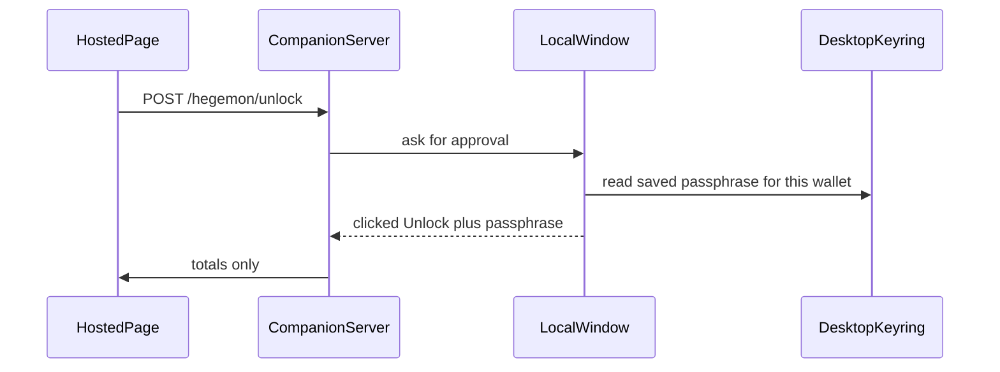

# Optional companion window

The terminal companion stays the default. `--gui` opens a local window beside it. The hosted page is unchanged: it still never receives the pairing token or the wallet passphrase.

## What the window does

- Shows the pairing token from the existing `--token-file` and a Copy button. The button writes only to the local clipboard and then says it copied. The token is not printed in the HTTP log.
- In `--hosted-wallet-status`, shows a passphrase field and a Remember checkbox. If a passphrase was remembered for this wallet file, the field is filled when the window opens. Unlock still requires a click, so opening the window does not scan by itself. That click replaces typing `UNLOCK` and the terminal passphrase prompt.
- Shows the same phase and block heights the terminal already prints, by reading `WalletActivity.snapshot()` in [`scripts/local_swap_companion.py`](scripts/local_swap_companion.py).

Colors and type follow [`BRAND.md`](BRAND.md): Deep Midnight background, Ionosphere for Copy and Unlock, Guard Rail for errors.

## Remembered passphrase

Store it in the desktop Secret Service, looked up by the wallet path, through `secret-tool` (no new Python dependency). The checkbox saves on a successful unlock and deletes the entry when it is unchecked. If the keyring is unavailable, Remember reports that and does not write a passphrase file.

The passphrase stays in the companion process, is wiped on exit, and is not added to `/hegemon/unlock`, `/hegemon/balance`, or `/hegemon/wallet-activity`.

## How it fits the current process

Tk must run on the main thread, so `--gui` starts the existing loopback server on a background thread and runs the window on the main thread. `confirm_unlock` and `read_passphrase` wait on that window instead of stdin. Without `--gui`, those functions and the interactive-terminal check stay as they are. `--gui` is allowed when stdin is not a terminal.

## Tests and docs

- Test the keyring helper with a fake `secret-tool`: save, fill, and delete, and reject a passphrase that would be written to a file.
- Test that a queued GUI approval satisfies unlock and that the activity JSON still has no passphrase.
- Skip opening a real window in the unit test.
- Update the hosted-wallet paragraph in [`DESIGN.md`](DESIGN.md) and [`METHODS.md`](METHODS.md), and the companion row in [`scripts/SWAP_SCRIPTS.md`](scripts/SWAP_SCRIPTS.md). Write the short ExecPlan required by [`.agent/PLANS.md`](.agent/PLANS.md).
