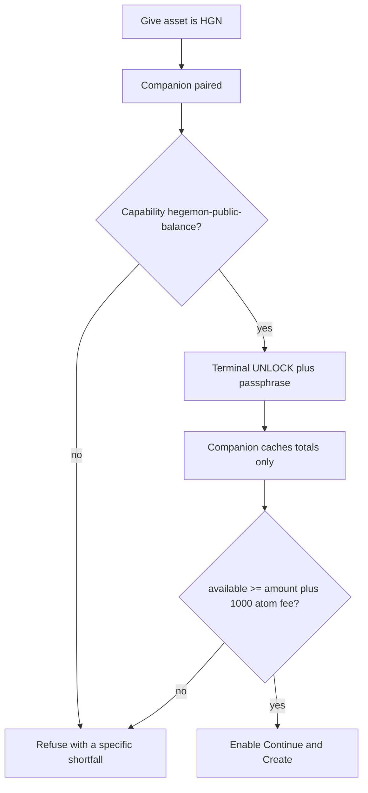

# Gate HGN offers on local wallet funds

The hosted page can already list an offer with no wallet at all. That stays true for Bitcoin, Ethereum and Cardano. For **Hegemon HGN as the give asset**, Create / Continue will refuse unless a live local read says the attached `private-spend` wallet has enough ordinary available atoms.

This is a **client-side snapshot**, not a lock. Coins can still move after the listing exists. The Cloudflare Worker will not try to prove Hegemon balances (it cannot see the encrypted store). A modified hosted page could skip the gate; that matches the existing trust model (the site operator is already a trust boundary).

## Why the current companion cannot do this

[`scripts/local_swap_companion.py`](scripts/local_swap_companion.py) `--hosted-node-status` is forbidden from taking `--hegemon-wallet`. It only serves `/health` and `/hegemon/status` (height, syncing, peers, `wallet_rpc_ready`). [`swap-ui/app.js`](swap-ui/app.js) then requires that exact capability list and never asks for a balance.

Hegemon balances are not on the node. They appear only after `private-spend status` unlocks [`alice.wallet` / `bob.wallet`](file:///home/william/.local/share/hegemon-testnet-wallets-20261104/testnet-wallets/hegemon-pre-mainnet/). That output includes note rows and must not be sent to the hosted origin.

## Companion: new hosted wallet-status mode

Keep `--hosted-node-status` unchanged so today’s pairing tests still pass.

Add `--hosted-wallet-status` (hosted origin only, mutually exclusive with Development actions and with `--hosted-node-status`). It requires the same pinned public identity as `--hegemon-public`: loopback RPC, [`config/testnet/0.11/release.json`](config/testnet/0.11/release.json) genesis, pinned manifest, and one `--hegemon-wallet`.

Capabilities become `hegemon-public-status` plus `hegemon-public-balance`.

New routes (still Bearer-token + hosted Origin, still loopback):

- `POST /hegemon/unlock` — companion prints a terminal prompt (`Type UNLOCK`, then the wallet passphrase with echo off). It runs `private-spend status`, parses the machine `balance synced_height=...` line already used by [`scripts/public_hegemon_wallet.py`](scripts/public_hegemon_wallet.py) `balance()`, and keeps **only totals plus passphrase** in process memory. Passphrase never goes to the browser, never to logs, and is wiped on exit.
- `GET /hegemon/balance` — if locked, `409` `{error:"wallet_locked"}`. If the node is syncing, missing wallet RPC, or public-tip check fails, `503` `{error:"hegemon_node_not_ready"}` (this correctly blocks HGN offers while the local node is behind). If ready, JSON with integer strings only: `available_atoms`, `reserved_atoms`, `htlc_atoms`, `immature_atoms`, `synced_height`, `watch_only`, `observed_height`. No note positions, no addresses, no status transcript.
- Re-sync on GET if the cache is older than 60 seconds or `synced_height` is more than 2 behind the node tip, using the in-memory passphrase so the user is not prompted again at publish.

One companion binds **one** wallet. Alice and Bob on this machine means restarting with the other `--hegemon-wallet`. Two concurrent wallets would need two ports; that is out of scope.

Spendable for the gate is `available_atoms` only. Reserved, HTLC and immature do not count. Watch-only cannot create a give-HGN offer. Required atoms are `give_amount + 1000` (public fee in [`PublicHegemonProfile`](scripts/swap_engine/adapters/hegemon_local.py)).

## Hosted page gate

Pure helper in [`swap-ui/offer-draft.mjs`](swap-ui/offer-draft.mjs), for example `hegemonGiveCovered(amountAtoms, availableAtoms, feeAtoms=1000n)`, with unit tests in [`swap-ui/offer-draft.test.mjs`](swap-ui/offer-draft.test.mjs).

[`swap-ui/app.js`](swap-ui/app.js) pairing: accept capability lists that **include** `hegemon-public-status` (status-only still connects). Record whether `hegemon-public-balance` is present. Do not unhide the old Development `#hegemon-actions` panel.

[`swap-ui/journey-ui.mjs`](swap-ui/journey-ui.mjs) give-amount step when give asset is `hegemon:hgn`:

- Show available HGN from the last balance read (format with existing `formatBaseUnits`).
- Unlock button calls `POST /hegemon/unlock` and tells the user to approve in the companion terminal.
- Continue is disabled until a successful comparison.
- Create/publish re-fetches `GET /hegemon/balance` and refuses if the snapshot is missing, stale, watch-only, node not ready, or short.

The advanced `#offer-form` submit path in `app.js` uses the same helper so guided and advanced cannot diverge.

Copy must say the listing still does not lock funds. Follow [`BRAND.md`](BRAND.md) for the give-amount status text (Ionosphere for the unlock action, Guard Rail for the shortfall).

After `swap-ui/` edits: `node scripts/build_client_manifest.mjs`.

## Tests and docs

- Extend [`scripts/test_local_swap_companion.py`](scripts/test_local_swap_companion.py): status-only still rejects wallet flags and `/hegemon/balance`; wallet-status mode returns totals-only JSON; a fake `private-spend` that prints note lines must not leak them on the wire.
- Extend [`swap-service/hosted-node-browser.test.mjs`](swap-service/hosted-node-browser.test.mjs) (or a sibling): status-only companion still connects; give-HGN Continue is refused; with a mocked unlocked balance above amount+fee, publish is allowed; below fee it is not.
- Update [`DESIGN.md`](DESIGN.md) hosted node-status subsection, [`METHODS.md`](METHODS.md) companion runbook, [`swap-ui/hosted.html`](swap-ui/hosted.html) / [`swap-ui/index.html`](swap-ui/index.html) start instructions, and [`swap-service/README.md`](swap-service/README.md).
- First implementation step: write `.agent/HOSTED_HEGEMON_BALANCE_GATE_EXECPLAN.md` per [`.agent/PLANS.md`](.agent/PLANS.md).

## Out of scope

ETH / BTC / ADA / token funding checks. Hegemon receive-side checks. Showing note lists or addresses in the browser. Changing the Worker offer API. Spending or proving through this hosted pairing path.
