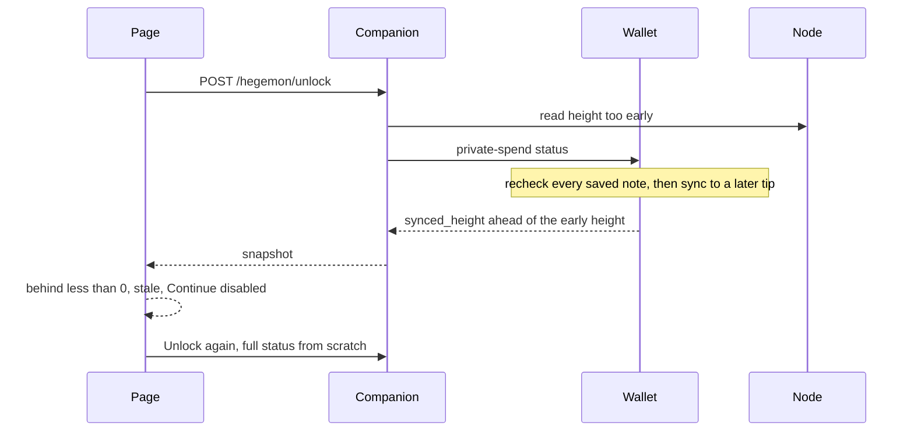

# Fix the HGN unlock loop

The amount step rejects a finished wallet snapshot, and the only button starts `private-spend status` over again. Two separate mistakes produce that loop.

The companion records the node height before the wallet run. Opening the wallet rechecks every saved note commitment before `status` asks for the tip (`WalletStore::open` calls `poseidon2_v8.validate`, which prints `wallet-progress stage=unlock current=<note index> target=<note count>`). Testnet blocks are 60 seconds apart. If one block arrives during that recheck, `synced_height` is ahead of the recorded `observed_height`. [swap-ui/offer-draft.mjs](swap-ui/offer-draft.mjs) treats any negative gap as stale, same message as a 60-second-old snapshot. Continue stays disabled.

The amount step then offers only Unlock, which always `POST`s `/hegemon/unlock`. That ignores the in-memory passphrase cache. The pipe-fed progress lines are also mislabeled: [scripts/local_swap_companion.py](scripts/local_swap_companion.py) classifies `stage=unlock` as a block sync, so the window says “Syncing the wallet: block 8724 of 36840” while it is recounting notes.

Do not widen the 60-second or two-block rule in the page. Do not change where the passphrase lives. A later `GET /hegemon/balance` already keeps the passphrase in the companion process and rescans only when the cached read is older than 60 seconds or the tip is more than two blocks ahead.

## Companion: stamp the tip after the read

In `HostedWalletSession.unlock` and the rescan branch of `balance` in [scripts/local_swap_companion.py](scripts/local_swap_companion.py):

- Run `private-spend status` first.
- Call `read_node()` after that command returns, and pass that height into `hosted_balance_view`.
- Tighten the cache predicate from `height - saved <= 2` to `0 <= height - saved <= 2`. A negative gap must not count as fresh. `caught_up` (`saved == height`) stays a cache hit.
- If the post-read tip is still more than 2 blocks ahead of `synced_height`, run `status` one more time with the passphrase already in hand. The wallet persists its height, so the second run only scans blocks mined during the first. Then read the node once more and stamp that height. Stop after that second run. If the gap is still over 2, return the snapshot and let the page refuse it. Do not loop.

`balance()` must set the same activity phase around a rescan that `unlock()` sets around its run, then return to idle. A refresh that has to scan should show progress in the window and on `GET /hegemon/wallet-activity`.

## Progress text

In `wallet_progress_event`, classify `wallet-progress stage=unlock` as history, not sync. Keep `stage=sync` as block heights. Put `kind` on the activity snapshot (`history` or `blocks`) while phase is `syncing`.

[scripts/local_swap_companion.py](scripts/local_swap_companion.py) `describe_companion_status` and [swap-ui/app.js](swap-ui/app.js) `describeWalletActivity` must use that kind:

- History: “Checking saved notes: 8724 of 36840.” No block wording.
- Blocks: keep “Syncing the wallet: block …”. The resume sentence stays when `resumed` is set.

The wallet binary already emits the numeric `wallet-progress` lines on a pipe. No wallet change is required for the label fix. The terminal-only sentences (“Checking wallet history”, “Resuming from saved block”) stay as they are.

## Page: refresh without a second unlock

In [swap-ui/journey-ui.mjs](swap-ui/journey-ui.mjs), first approval still calls `unlock()`. After a snapshot exists, the button reads “Read balance again” and calls `balance()`. If that returns the locked-wallet error, fall back to `unlock()`.

On Continue for a hosted HGN give, if the stored snapshot fails `assertHegemonGiveSnapshot` only because it is stale, call `balance()` once and test the new snapshot before showing the error. A shortfall or a watch-only wallet still fails immediately, with no extra read. Publish already calls `balance()`; leave that call.

Do not poll balance on a timer.

## Docs and manifest

Write a living ExecPlan at [.agent/HGN_SNAPSHOT_FRESHNESS_EXECPLAN.md](.agent/HGN_SNAPSHOT_FRESHNESS_EXECPLAN.md) per [.agent/PLANS.md](.agent/PLANS.md), and keep its Progress and Decision Log current while implementing.

Update the hosted HGN funding paragraph in [DESIGN.md](DESIGN.md) so it says the node height is read after `status` returns, a repeat approval uses the cached balance read, and note-history progress is not a block count. Mirror that in the companion section of [METHODS.md](METHODS.md) if that section describes the old order. Rebuild the hosted client with `node scripts/build_client_manifest.mjs` because [swap-ui/app.js](swap-ui/app.js) and [swap-ui/journey-ui.mjs](swap-ui/journey-ui.mjs) are integrity-checked.

## Tests

Extend [scripts/test_local_swap_companion.py](scripts/test_local_swap_companion.py):

- A node height that moves during `status` is the height on the returned snapshot, not the height from before the run.
- A post-read gap of more than 2 blocks causes exactly one extra `status`, then stops.
- `stage=unlock current=8724 target=36840` is history, and the companion status sentence says saved notes, not blocks.
- Update the activity snapshot equality assertion for the new `kind` field.

Extend [swap-service/hosted-hgn-gate-browser.test.mjs](swap-service/hosted-hgn-gate-browser.test.mjs): after a successful unlock, a snapshot whose `observed_at` is old causes one `GET /hegemon/balance` and no second `POST /hegemon/unlock` when the user continues or clicks the read-again button. The existing short-balance and funded-offer cases must still pass.

Leave the stale rules in [swap-ui/offer-draft.test.mjs](swap-ui/offer-draft.test.mjs) as they are, including rejection of a negative height gap.

Run:

- `node --test swap-ui/offer-draft.test.mjs`
- `PYTHONPATH=scripts python3 -m unittest discover -s scripts -t scripts -p 'test_local_swap_companion.py'`
- `CHROMIUM_PATH=/usr/bin/chromium node --test swap-service/hosted-hgn-gate-browser.test.mjs swap-service/journey-browser.test.mjs`

The browser tests are the UI check. A live wallet on the public testnet is not required for these tests.