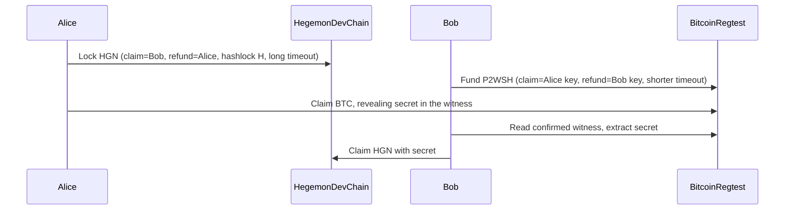

# Local HGN/BTC HTLC swap end-to-end test

## What already exists and what is missing

- [scripts/development_atomic_swap_rehearsal.py](scripts/development_atomic_swap_rehearsal.py) already drives both chains: Bitcoin Core regtest RPC plus the `launch_wallet_prepare htlc ...` commands. It assumes a Hegemon node is already running, the wallet stores are already funded and synced, and the lock note position is supplied by hand.
- It also mixes up the two parties: the Bitcoin "claim" wallet and the Hegemon `claim_store` both claim. In a real swap, the person who holds the secret (Alice) claims BTC, and the counterparty (Bob) claims HGN.
- [scripts/check_native_asset_lifecycle.py](scripts/check_native_asset_lifecycle.py) already shows how to start a fresh Development node:
  - `hegemon-node --print-development-candidate-manifest --development-funding-address ADDR`
  - set `pow_bits = 0x207fffff`
  - `--dev --network development --network-manifest M --development-candidate --base-path ... --rpc-methods unsafe`
  - mine to height 121 so the first block reward matures.
- [scripts/development_wallet_context.py](scripts/development_wallet_context.py) writes the wallet context file from the running node.
- [experimental/htlc-prototype/bitcoin-regtest/fetch_core.sh](experimental/htlc-prototype/bitcoin-regtest/fetch_core.sh) downloads Core 31.1 into a local directory and verifies its GPG signature and SHA-256. It installs nothing system-wide.

## Roles (fixed across all scenarios)

- **Alice** holds HGN and generates the secret.
  - Hegemon: her wallet is the refund side of the HGN lock, and it receives the mining payout that funds her.
  - Bitcoin: she holds the BTC claim key.
- **Bob** holds BTC.
  - Hegemon: his wallet is the claim side of the HGN lock.
  - Bitcoin: he holds the BTC refund key, and his regtest wallet is funded by mining 101 blocks to his address.
- **Treasury** is a throwaway wallet used only as the manifest funding recipient.
- **Timing**: the Hegemon timeout must be longer in wall-clock time than the Bitcoin refund height, using the existing `HtlcOffer::check_timeout_margin` in [wallet/src/htlc.rs](wallet/src/htlc.rs).

## Scenarios

Each scenario gets its own new temporary root, Hegemon chain, regtest chain and wallets.

1. **happy**: runs the diagram above. Alice ends owning the BTC output and Bob ends owning a Hegemon note worth `value - fee`.
2. **no_btc**: Alice locks HGN and Bob never funds BTC. Alice's early refund is rejected. After the Hegemon timeout, her refund succeeds and she owns `value - fee` again.
3. **both_refund**: both sides lock and Alice never claims.
   - Bob's early BTC refund is rejected. At the Bitcoin refund height, his refund confirms back to his wallet.
   - Alice's early HGN refund is rejected. After the Hegemon timeout, her refund confirms.
4. **late_claim**: Alice claims BTC, but Bob waits past the Hegemon timeout.
   - Alice refunds HGN first and it confirms canonically.
   - Bob then imports the secret from the Bitcoin chain and tries `prepare-claim`. The test requires this to be rejected, with no new artifact and no accepted attempt.
   - This records the known claim/refund race after the timeout; no claim deadline exists.

The existing negative checks (wrong secret on both chains, premature refunds on both chains, an orphaned Bitcoin witness not treated as confirmed) are kept in the happy scenario.

## Implementation

- **Shared library**: move the reusable pieces out of `development_atomic_swap_rehearsal.py` into a new [scripts/htlc_swap_lib.py](scripts/htlc_swap_lib.py):
  - `BitcoinRPC`, `spend_contract`, `require_rejected_contract_spend`
  - `confirmed_bitcoin_preimage`, `hgn_action`, `hgn_status`, `hgn_mine_to`
  - `run_wallet_cli`, `require_cli_rejection`, `descriptor_checksum`
  - The old script keeps its CLI and imports from the library, so [scripts/development_htlc_reorg_rehearsal.py](scripts/development_htlc_reorg_rehearsal.py) keeps working.
- **New orchestrator** [scripts/local_htlc_swap_e2e.py](scripts/local_htlc_swap_e2e.py):
  - **Build**: one `cargo build --release` of `hegemon-node` with features `development-candidate` and `poseidon2-v8-retained-test-support`, plus the `wallet` examples `launch_wallet_prepare` and `htlc_public_fixture` with `poseidon2-v8-retained-test-support`. Skip with `--no-build`.
  - **Bitcoin Core**: if `~/.cache/hegemon/bitcoin-core-31.1/bitcoin-31.1/bin/bitcoind` and a matching `release-verification.json` are present, reuse them. Otherwise run `fetch_core.sh` into a fresh directory and move it into the cache. The daemon only ever runs with `-regtest -listen=0 -connect=0 -dnsseed=0` on loopback, so nothing syncs from the network.
  - **Per scenario**:
    - Create a mode-0700 temporary root, random passphrase files and free ports.
    - Create wallets offline.
    - Generate the manifest from the treasury address, start the node with `HEGEMON_MINER_ADDRESS=<Alice>` and `HEGEMON_SEEDS=""`, then write the context.
    - Run `init` and `sync` for each wallet.
    - Mine to 121 or more, then choose one of Alice's mature reward notes as the exact lock input. Set `value = note_value - fee` so `prepare-lock` needs no split.
    - Start the regtest daemon, create the `alice`, `bob` and `miner` wallets, and mine to Bob.
    - Run the scenario's steps, assert ownership with `require_exact_owned_note` and `require_bitcoin_receive`, then write a sanitized JSON receipt.
  - **Teardown**: always SIGTERM, then kill and reap both daemons. Keep the temporary root on failure (and with `--keep`) for debugging. Exit non-zero if any scenario fails, and print a per-scenario pass/fail summary.
  - **Flags**: `--scenario {happy,no_btc,both_refund,late_claim,all}` (default `all`), `--bitcoin-core-dir`, `--keep`, `--no-build`.
- **Makefile**: add a `htlc-swap-e2e` target that runs `python3 scripts/local_htlc_swap_e2e.py --scenario all`.
- **Fast tests**: add [scripts/test_local_htlc_swap_e2e.py](scripts/test_local_htlc_swap_e2e.py) as a unittest that needs no daemons. It covers role and descriptor construction, the timeout margin choice, and refusal of non-loopback or non-empty roots.

## Known risk, checked first (milestone 0)

The manifest needs a funding address, and the node needs a miner address, before any node exists. However, `launch_wallet_prepare init` needs a running node for its context.

- The first spike creates the stores offline, using either `walletd` `asset.address` with `create=true` or `private-spend --wallet X bootstrap-address --index 0` (both are already used by existing lifecycle scripts).
- It then confirms that `launch_wallet_prepare init` opens the same store and reports the same `primary_address`.
- If neither works, add a small offline `address` subcommand to [wallet/examples/launch_wallet_prepare.rs](wallet/examples/launch_wallet_prepare.rs) that uses `WalletStore::create_full_if_missing` and `primary_address`, with no RPC.
- The spike also confirms the coinbase maturity height and that the mature reward note is accepted as an exact-value Lock input on this manifest.

## Docs and constraints

- Add an ExecPlan at `.agent/LOCAL_HTLC_SWAP_E2E_EXECPLAN.md` (per `.agent/PLANS.md`) and keep it updated.
- Update [METHODS.md](METHODS.md) in the "Development-only candidate and HTLC rehearsals" section, the `DESIGN.md` rehearsal paragraph, and [runbooks/pre_mainnet_rehearsal.md](runbooks/pre_mainnet_rehearsal.md) step 4 to point to `make htlc-swap-e2e`.
  - State that it is local Development and regtest evidence only and grants no production authority.
  - State that the test isolates the Hegemon node (`HEGEMON_SEEDS=""`), so no seed list applies to it. Shared mining operators must still use the approved `HEGEMON_SEEDS` list and keep NTP or chrony enabled.
- Not added to CI. Proof generation and the Core download are too heavy for that, so this is a local command only.
- Expect a long runtime, roughly minutes per Lock, Claim or Refund proof. Development mining stays paused while each Lock is proved, because the Lock requires the reference parent to equal the current tip.