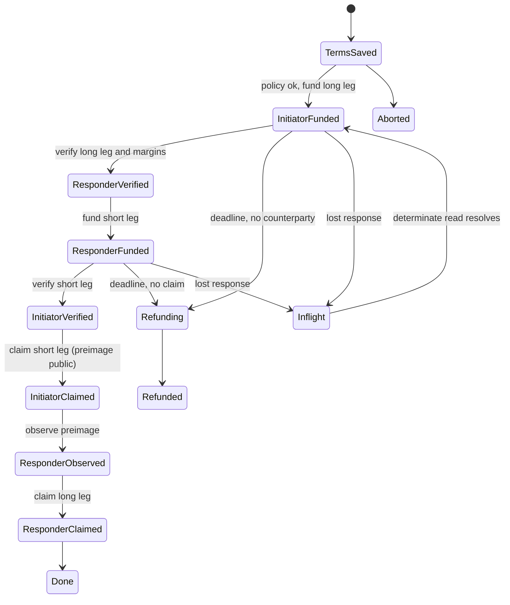

# Plan 2 of 8: Two-party swap state machine

Depends on P0 and P1 (deadline policy). Feeds P3 (UI), P4 (Bitcoin runs), P6 (Hegemon adapter).

## Problem

Public swaps today are pairwise scripts (`scripts/public_btc_eth_rehearsal.py`, `public_eth_cardano_rehearsal.py`, `public_btc_cardano_rehearsal.py`, `public_samechain_*`, and `public_bitcoin_suite.py`), each with its own state file and ordering. Nothing generically verifies both legs, enforces deadline margins, observes the revealed preimage and drives claim or refund. The plans call this the main gap ("These manual actions do not coordinate a swap").

## Design

New package `scripts/swap_engine/` (kept alongside the existing flat scripts, which stay working).

- `adapter.py`: a `ChainAdapter` interface: `head()`, `verify_escrow(terms)`, `fund(terms)`, `claim(terms, preimage)`, `refund(terms)`, `observe_claim(terms)`, plus `finality(txid)`. Implementations wrap the existing, tested drivers instead of rewriting them: `public_bitcoin_driver.py`, `public_sepolia_driver.py`, `public_cardano_driver.py`, `public_testnet_observers.py`, `public_*_verify.py`.
- `adapters/hegemon_stub.py`: interface-conformant stub plus an in-memory fake used by tests. The real adapter is P6.
- `store.py`: durable per-swap record using the same discipline as `scripts/public_swap_journal.py` (private 0700 directory, exclusive writes, fsync, `prepared_or_submitted` before any broadcast, never retry a broadcast automatically). Holds terms, role, chain identities, hashlock; the preimage is kept separate and never logged.
- `engine.py`: a pure transition function `(record, observations, policy) -> next_action`, and an executor that performs at most one action per `advance` call and then persists. `inflight` always blocks automation until a human or a determinate chain read resolves it.
- Policy checks come from P1 before funding and before claiming.
- Roles: initiator (knows preimage, funds long leg, claims first) and responder.

## Steps

1. Write `.agent/SWAP_ENGINE_EXECPLAN.md`; consult `DESIGN.md` and `METHODS.md`.
2. Read the existing drivers and rehearsals to catalogue the exact calls each adapter needs and the failure modes already handled (HTTP 429 fallback, Koios unindexed CBOR, Sepolia lagging reads, Cardano fee-input token preservation).
3. Implement the adapter interface, store and engine with a deterministic simulated-chain harness first.
4. Fault-injection tests: lost submission response, provider 429, reorg that drops a funding or claim, process kill and restart at every persisted state (enumerate all transitions), counterparty never funds, counterparty claims at the last allowed moment, preimage observed before confirmation.
5. Wrap the real Bitcoin, Sepolia and Cardano adapters and run local-fixture swaps (Anvil, bitcoind regtest, local Cardano) for every pair and both same-chain cases. Reuse `htlc_counterpart.py` fixtures.
6. Re-express one existing public scenario (BTC/ETH native) as an engine scenario and, once P0/P4 confirm funds, run it for real on testnets as the acceptance run. Keep the old scripts and their tests.
7. Add a CLI `scripts/swap_engine_cli.py` (`init`, `status`, `advance`, `explain`) with no secrets in args or logs.
8. Update `DESIGN.md` and `METHODS.md`.

## Acceptance

- Crash-at-every-state tests never lose funds or double-submit.
- All local pair fixtures pass through the engine.
- One real public-testnet swap completes via the engine with confirmed transaction IDs recorded.

## Revisions from earlier plans

Revision from P0 (2026-11-05):
- Add a first step: install or locate Foundry (`anvil`, `forge`), Bitcoin Core 32.x, cardano-cli/cardano-node and Ogmios. None are on this host, so local-fixture swaps (step 5) and the six Python test files that need them cannot run until then. Aiken exists at `~/.aiken/bin/aiken`.
- Adapters and fixtures must read tool locations from configuration or environment variables, not the hard-coded `/workspace/chain-tools/...` and `/workspace/bitcoin-32.1/...` paths now in `scripts/test_public_*.py` and the scripts they import.
- Ethereum adapter needs an explorer fallback (Blockscout `https://eth-sepolia.blockscout.com/api/v2`) for events and receipts older than about 12,000 blocks, because the default public RPC prunes them.
- The public acceptance run (step 6) uses fresh disposable wallets unless P0's private-state decryption succeeds and leftover funds are sufficient. P0 shows no known live escrows, so there is no recovery pressure.
- Second revision from P0 (2026-11-05): the private journals are recovered at `~/.hegemon-private/restore/historical-testnet-journals-20261102` (0700, secrets inside). Use their shapes (86 `prepared_or_submitted` records, `state.json` phases `complete`/`submitted`) as ground truth for the store and fault-injection tests, copying only structure, never secrets. The existing public wallets hold about 0.15 ETH, about 19,977 ADA and 94,748 satoshis, enough for the public acceptance run, so no new faucet funds are needed; the active wallet directory is `~/.local/share/hegemon-testnet-wallets-20261104`.
- Bitcoin claim and refund transactions observed on testnet4 are the reference shapes for the Bitcoin adapter: claim witness is signature, 32-byte preimage, true selector, script; refund witness is signature, empty selector, script, with locktime set.

## Last step: revise later plans

Update the master ExecPlan and edit P3..P7:
- P3: the state schema and transition vectors the browser reducer must match, and a decision on whether the UI embeds a JS port or talks to a local engine process.
- P4: whether Bitcoin cases should be finished with the engine or with `public_bitcoin_suite.py`.
- P5: which identity fields (addresses per leg) the record needs to bind.
- P6: the exact `ChainAdapter` contract and Hegemon-specific inflight needs.
- P7: scripts now superseded and test entry points to add.
