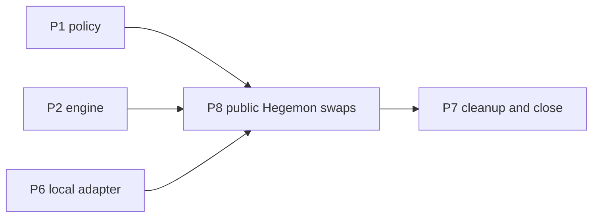

# Plan P8: Public Hegemon swaps

Series position: P0 baseline (done), P1 deadline policy, P2 state machine, P3 UI wallets, P4 Bitcoin cases, P5 relay identity, P6 Hegemon offline adapter, **P8 public Hegemon swaps (this plan)**, P7 cleanup/docs/CI (stays last and closes the series). P8 depends on P1 (policy), P2 (engine) and P6 (local Hegemon adapter). It is numbered P8 to avoid renumbering P7.

## What I found (read-only, 2026-11-05)

- The public chain is moving again. [status.json](https://hegemon.pauli.group/testnet/status.json) reported height 9978, 14 peers, not syncing, an average of about 81 s per block over the last 120 blocks (9,785 s), same genesis `0xd9a8cfc1...9ad3` and chain ID as [release.json](config/testnet/0.11/release.json), software 0.11.2.
- This PC already runs a node: `target/release/hegemon-node --network pre-mainnet` (pid 185459, since Nov 4), RPC on `127.0.0.1:9944`, P2P on `0.0.0.0:30333`, 7 peers, data in `~/.hegemon-node-v0.11` (583 MB). Its genesis matches. But its tip was stuck at height 9924 for the whole observation (about 87 minutes behind wall clock, `isSyncing: true`), 54 blocks behind the public tip. The earlier Tailscale tunnel idea (`~/Downloads/hegemon_tailscale_status.py`) is no longer needed.
- Encrypted Hegemon wallets for Alice and Bob exist in `~/.local/share/hegemon-testnet-wallets-20261104/testnet-wallets/hegemon-pre-mainnet/` (with `.pass` files and `.lock` files). Their balances are unknown. The journals README says a Bob funding transfer exists only on this PC.
- `target/release/private-spend` is not built. The branch adds `verify-htlc` to [private_spend.rs](wallet/src/bin/private_spend.rs) (plus a helper in [private_spend_build.rs](wallet/src/private_spend_build.rs)); the released binary lacks it. `private-spend` already has `lock`, `claim`/policy-spend, `refund` handoff export, `ordinary`, `status`, `submit`.
- Disk is 95% full (25 GB free); the node already uses about 1.1 GB RSS and a Hegemon proof needs about 1.7 to 2.0 GB.
- Hegemon is private: a lock's terms are not publicly verifiable on chain. The counterparty can verify only after importing the lock's encrypted handoff, and a claim reveals the preimage publicly only if the lock was created with the opt-in disclosure flag.

## Steps

1. Revise the series. Add P8 to `.agent/SWAP_SERIES_EXECPLAN.md` (series list, progress, revision log); edit P6's last step so it hands off to P8 and P7; edit P7 so its docs, PR split and backlog include P8; tell P1 to use the measured Hegemon block data below. Create `.agent/HEGEMON_PUBLIC_SWAPS_EXECPLAN.md` per `.agent/PLANS.md`. Consult `DESIGN.md`, `METHODS.md`, `config/testnet/0.11/README.md`, `DEBUG_SYNC.md` and `.agent/TESTNET_NODE_MEMORY_SYNC_RECOVERY_EXECPLAN.md`.
2. Get a node that follows the chain. Never delete `~/.hegemon-node-v0.11` or wallets (the join guide forbids it). Diagnose why the local node is stuck (check how it was started, its logs, peers, clock sync, disk). Restart with the packaged launcher using `--wallet-rpc` on loopback only, mining off (`HEGEMON_MINE=0`, empty `HEGEMON_MINER_ADDRESS`), correct seeds and NTP/chrony active. Run `scripts/probe_hegemon_testnet.py --rpc http://127.0.0.1:9944` to confirm genesis, chain ID, manifest and the required wallet methods. Acceptance: local height within 2 blocks of status.json and advancing across several blocks. If the stall is a node bug, record it in `.agent/` with logs and use a fresh data path instead of touching the old database.
3. Build the wallet binary. `cargo build --locked --release -p wallet --bin private-spend` with default features (no `private-spend-dev-artifacts`), after checking free disk (clear only build artifacts you created). Record its SHA-256 and confirm the branch differs from main only in the two wallet files above, so spending logic matches the qualified release.
4. Inspect wallets and funding. Confirm no process holds the `.wallet.lock` files, then run `status` for Alice and Bob against the synced loopback node (passphrases supplied through a pseudo-terminal as `scripts/hegemon_action_runner.py` already does, never on the command line or in logs). Record exact available, reserved and immature HGN. Decide the minimum swap amount (a few thousand atoms plus fee; 1 HGN is 100,000,000 atoms). If balances are insufficient, ask the user whether to send from the treasury or mine; mined rewards need 120 blocks (about 2.7 hours) to mature.
5. Calibrate timing for P1. Using the local node's block timestamps over at least 500 blocks, compute the real inter-block distribution (mean about 81 s, plus spread), and combine it with the 14-block minimum lock window and measured proof time and RSS. Write these into `config/swap/chain-timing.json` for Hegemon. Expect a minimum lock of roughly 20 minutes of wall time and proof times of 1 to 3 minutes; choose generous timeouts.
6. Add a public profile to the Hegemon adapter. The local companion and runner insist on a peerless Development node. Add an explicit, separate public mode (do not weaken local mode) that requires: the pinned manifest and genesis, loopback RPC, at least a minimum peer count, a tip within 2 blocks of the independent status.json, NTP sync, a single-submission journal before every submit, and `inflight` blocking for lost responses. Hegemon preimage observation uses canonical action bytes (`scripts/watch_hegemon_preimage.py`); make its confirmation depth a P1 parameter, because a PoW reorg can orphan a claim while the preimage stays public.
7. Public smoke tests, smallest amounts first: (a) an `ordinary` Alice to Bob transfer, submit, confirm and re-sync both wallets; (b) a lock from Alice to Bob with an encrypted refund handoff, then verify with `verify-htlc` on Bob's wallet and let it expire and refund (about 20 to 25 minutes), measuring proof time and memory. Do not start swaps until both pass.
8. Run public swaps through the P2 engine, one pair at a time, each with its refund counterpart: HGN with Sepolia ETH, then HGN with Bitcoin testnet4, then HGN with Cardano preview ADA, then token pairs if time allows. For each pair test both directions, because who claims first decides who must have created the lock with preimage disclosure. Also test: counterparty never funds (refund), claim attempted after the P1 cutoff (must be refused or fail safe), and engine restart during a proof. The lock handoff goes over files first; carry it over the encrypted relay messages once P5 identity is available.
9. Hosted UI and companion. Keep the hosted page's Hegemon leg labelled as requiring a local companion (the hosted page cannot reach loopback). If time allows, extend `scripts/local_swap_companion.py` public mode so the guided flow can drive Hegemon actions locally with the same terminal approvals; otherwise record it as a follow-up.
10. Record and document. Add Hegemon public results to `PUBLIC_TESTNET_RESULTS.md` using only public data (action IDs, block heights, hashlocks, per-chain transaction IDs; never openings, handoffs, preimages or passphrases). Update `DESIGN.md` and `METHODS.md` (public Hegemon profile, timing, disclosure semantics) and `swap-service/README.md` (replace the stale statement that Hegemon public-testnet verification is unavailable). Runbook notes must include `HEGEMON_SEEDS="hegemon.pauli.group:30333,devnet.hegemonprotocol.com:30333"` (all nodes and miners share one seed list to avoid forks) and the NTP/chrony requirement because future-skewed PoW timestamps are rejected.
11. Hygiene: wallet RPC stays on loopback; no mining from this PC unless the user asks; `.pass` files and wallets are never committed or copied; the secret scan covers new journals.

## Acceptance

- Local node follows the public tip and survives a restart.
- `private-spend status` works for both wallets on the public chain.
- At least HGN with ETH and HGN with Bitcoin each complete a swap (claim on both sides), and at least one pair refunds correctly, all verified on both chains with public identifiers recorded.
- P1 policy accepted every public run, and the late-claim case was refused.

## Risks

- The public testnet could stall again, or the local node could fall behind; have the plan pause cleanly at any step with no live escrow left unrefunded, and prefer short refund windows for tests only within P1's margins.
- Low disk (25 GB) and memory pressure during a proof next to the node.
- A PoW reorg can orphan a Hegemon claim or lock; confirmation depth and refund timing must absorb it.

## Revisions from earlier plans

Revision from P1 (2026-11-05):
- Step 5 (timing calibration) is largely done. P1 measured 3,000 public Hegemon blocks (explorer `/testnet-api/v1/blocks?limit=50`, paged with `next_before`): mean 75.8 s outside outages, 12 blocks as quick as 124 s, 144 blocks between 8,572 s and 13,449 s, and one 81,258 s (22.6 hour) stall. Remaining here: rerun `python3 scripts/measure_chain_timing.py hegemon-pre-mainnet 3000 --update config/swap/chain-timing.json` after the local node is synced and compare against its own block timestamps, then replace `proveSeconds` (300 now) with real measured proof times.
- The expectation "minimum lock of roughly 20 minutes" is for a lone lock only. For a swap, the policy needs a Hegemon leg to have at least 577 blocks (about 12 hours typical, 4.8 hours at the fast bound) before timeout, and a Hegemon long leg paired with an Ethereum or Cardano short leg needs about 865 blocks. A Hegemon long leg with a Bitcoin short leg needs about 14,400 blocks. Budget hours to a day per refund case. Only the single-leg smoke tests in step 7 may use the relation minimum plus a margin (about 17 blocks) and must be labelled outside the policy.
- Pass `--min-confirmations` and `--min-remaining-blocks` to `private-spend verify-htlc` from `legRequirements`, and report the head as `{observedAt, height}`. The claim cutoff must be enforced by the engine: Hegemon accepts a late claim until the refund lands.
- Risk: the 22.6 hour stall exceeds the policy's 2 hour outage allowance. A swap with a Hegemon short leg is exposed to a repeat; say so in the runbook and prefer Hegemon as the long leg when pairing with a time-based chain.
- Choose pairs in this order: HGN with Ethereum or Cardano first (policy windows of hours), HGN with Bitcoin last (windows of days).

Revision from P2 (2026-11-06):
- Run these swaps through the P2 engine (`scripts/swap_engine_cli.py`), not new one-off scripts. The engine, planner, store, journal recovery and CLI are done and a real public Ethereum/Cardano swap ran end to end in about seven minutes (see `.agent/SWAP_ENGINE_EXECPLAN.md` Artifacts). P6 supplies the real Hegemon adapter; until then `build_adapter('hegemon')` returns the stub, which refuses every write.
- Expiries must come from `planner.plan_with_margin` on live heads, not raw `plan_timeouts`. Allow for proving time in the Hegemon leg (`proveSeconds` is 300 in the config) and for the 22.6 hour stall the outage allowance does not cover; if a stall occurs mid-swap the engine waits, and a refund that becomes due while the chain is down is taken only when the head shows it is due.
- Pair order stays Ethereum and Cardano first, Bitcoin last. Bitcoin/Hegemon needs days; the planner refuses any pair whose horizon exceeds 30 days (Bitcoin/Bitcoin already fails).
- Public wallets (read 2026-11-06): Sepolia Alice about 0.1478 ETH and Bob about 0.0022 ETH (a claim costs under 0.00001 ETH at current gas); Cardano Alice and Bob each have several ADA-only outputs of at least 5 ADA, which the adapter needs for fee and collateral; Bitcoin Bob's outputs are only 1,250 sats each (see P4).
- Provider behaviour to plan around: Koios intermittently answers `[]` for confirmed transactions and the Cardano adapter treats that as unavailable; the public Ethereum RPC cannot show mempool claims and sometimes returns no receipt for a mined transaction; the engine treats both as "wait".
- Refund cases: simulated chains and local Anvil, bitcoind and Cardano clusters already cover refund after the counterparty never funds, and both-sides-refund after the initiator vanishes. The public Hegemon refund cases still need real runs.

Revision from P3 (2026-11-06):
- The hosted UI step (`p8-ui`) is small: the guided view already labels the Hegemon leg "unavailable on public testnet" and reports a leg with no reader as not readable. To make the Hegemon leg observable in the page, add `readers.hegemon` in `swap-ui/app.js` backed by a Worker route or the loopback companion and remove the label; the Worker's CSP forbids direct node access. The observer section needs a Hegemon option only if the page should find a Hegemon preimage; the existing Python observers (`public_hegemon_preimage_observer.py`) remain the reference.
- Public-testnet pairs through the page exist for Sepolia, Cardano preview and Bitcoin testnet4 (qualified 2026-11-06 with stand-in wallets), so HGN/ETH, HGN/ADA and HGN/BTC swaps can have their non-Hegemon leg verified, claimed and refunded from the hosted page while the Hegemon leg runs through the engine and companion.

Revision from P4 (2026-11-06):
- A Bitcoin leg paired with a Hegemon leg needs a refund height at least 145 blocks (about two days) out and, as the long leg, further; the old Bitcoin pairs were funded about 141 blocks out and would be rejected today, so do not reuse their margins. Use `plan_with_margin` through the engine and expect waits of days for Bitcoin refunds.
- Record the full terms and hashlock of every escrow before funding it, in the engine store and in the run's results file; P4 found two Bitcoin escrows from earlier qualification runs that can never be spent because the hashlock was lost with the browser session.
- After each public Hegemon swap, re-verify it from public data in the style of `scripts/verify_public_btc_cases.py` (terms from the record, hashlock match, claim order against both deadlines, the retroactive policy verdict), and record `observedAt` and the chain head with every observation because testnet4 header times cannot reconstruct the order later.

Revision from P5 (2026-11-06):
- Identity for the Hegemon leg stays `pending` (unverified, never reported as verified) until a Hegemon identity scheme exists; the statement format, the validators and the pair check already carry the slot, and the work to fill it is listed in the P6 revision. A public HGN/ETH, HGN/BTC or HGN/ADA swap run through the hosted page therefore has both participants publish a statement whose non-Hegemon leg is proven by a wallet signature and whose Hegemon leg is shown as unverified. Record the identity codes and the `identities` engine record in the run's results file and say that the Hegemon side was unauthenticated.
- The hosted public pair check now refuses to run until both signed identities exist and match the escrow addresses (Bitcoin keys, Ethereum addresses, Cardano key hashes). Escrow terms for the non-Hegemon leg must therefore use the same addresses the participants signed, and the Hegemon leg is still not compared because `check_terms` returns no participants for it.
- The new Worker and the D1 migration are not deployed. Before any public run that uses the hosted relay, the operator applies `migrations/0002_identity.sql` and deploys the Worker (runbook in `swap-service/README.md`), then runs `scripts/verify_hosted_client.mjs`; runs against the local relay need nothing.
- The hosted page's content security policy is `connect-src 'self'`: the `p8-ui` Hegemon reader in the hosted page has to go through a fixed Worker route, not a direct node URL. After any change to a file in `swap-ui/`, run `node scripts/build_client_manifest.mjs` or the browser will refuse to load the page.

## Last step: revise later plans

Update the master ExecPlan and edit the plans that remain:
- P7: Hegemon public docs, runbook notes, the test targets that need a live node (opt-in), PR split including P8 artifacts, and the follow-up backlog (public gateway, relay-carried handoffs, public identity scheme).
- P1: any change to Hegemon timing numbers learned from the public chain.
- P5 (if not yet done at that point): the Hegemon identity field requirements discovered during handoff exchange.
