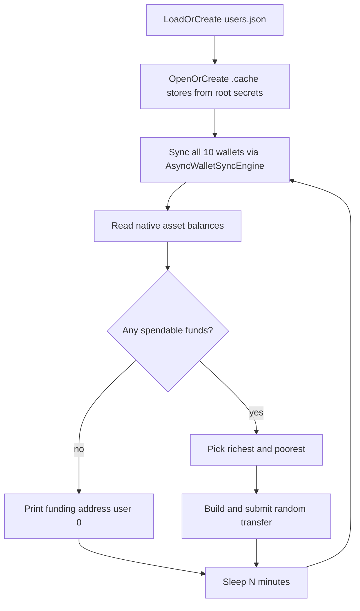

# User transfer simulator

## Goal

Ship a local-only load/activity tool that keeps **all simulated identities in one gitignored `users.json`**, with no loose wallet exports in the repo root.

## Layout

New workspace member [`tools/user-sim/`](tools/user-sim/):

- [`tools/user-sim/Cargo.toml`](tools/user-sim/Cargo.toml) — depend on workspace `wallet`, plus `anyhow`, `clap`, `hex`, `rand`, `serde`/`serde_json`, `tokio`
- [`tools/user-sim/src/main.rs`](tools/user-sim/src/main.rs) — CLI + loop
- [`tools/user-sim/README.md`](tools/user-sim/README.md) — how to run against a local node and fund the printed `shca1…` address

Wire into [`Cargo.toml`](Cargo.toml) workspace `members`.

Gitignore (in [`.gitignore`](.gitignore)):

- `tools/user-sim/users.json`
- `tools/user-sim/.cache/`

`users.json` is the only durable identity file. Encrypted note stores for sync/spend live under `.cache/` (also ignored) so the workspace stays clean and sync does not full-rescan from genesis every tick.

## `users.json` schema

```json
{
  "users": [
    {
      "id": 0,
      "root_secret": "<64 hex chars>",
      "address": "shca1..."
    }
  ]
}
```

- First run: create **10** users via `RootSecret::from_rng` + diversifier index `0` address (`keys.address(0)?.shielded_address().encode()`), same path as [`wallet` generate](wallet/src/bin/wallet.rs).
- Later runs: load existing file; never regenerate if present.
- File mode `0600` via `wallet::store::write_private_file` where practical.

## Runtime behavior

Defaults: `--rpc-url http://127.0.0.1:9944`, `--interval-mins 5`, data dir = crate directory (`CARGO_MANIFEST_DIR`).

Each tick:



1. For each user, ensure a `WalletStore` at `.cache/user-{id}.store` with a fixed simulator passphrase (`create_from_root` if missing, else `open`). Root secret always comes from `users.json`.
2. Connect `NodeRpcClient` to the local RPC URL; `AsyncWalletSyncEngine::sync_once` for every store.
3. Read `store.balances()` for native asset (`0`). Treat “has funds” as any user with spendable native balance `> 0`.
4. **No funds:** print user `0`’s `address` (and a one-line hint to fund it / set `HEGEMON_MINER_ADDRESS`).
5. **Has funds:** choose richest and poorest by spendable native balance (stable tie-break by `id`). If they are the same user (only one funded or all equal on one account), skip send and log why. Otherwise pick `amount` uniformly in `1..=richest_balance` (fee `0` for local), build recipients, prove/submit the same way [`cmd_node_send`](wallet/src/bin/wallet.rs) does (`build_transaction` → `submit_transaction` / existing wallet send helpers). Log from/to/amount/txid.
6. Sleep `interval_mins` and repeat forever (Ctrl-C exits cleanly).

## Prerequisites (README)

Operator must already have a local node, e.g.:

`HEGEMON_MINE=1 ./target/release/hegemon-node --dev --tmp`

with loopback unsafe RPC so `hegemon_submitAction` works. Sync needs time after funding before the first transfer tick succeeds.

## Out of scope

- Testnet / remote RPC
- Transparent balances
- Multi-asset transfers
- DESIGN/METHODS architecture changes (tooling only)