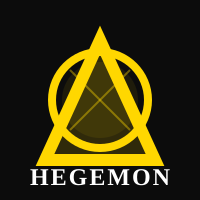

# Documentation Hub

This `docs/` tree centralizes contributor-facing material for the Hegemon monorepo. Everything here is considered normative alongside `DESIGN.md` and `METHODS.md`; when you change implementation code, update the relevant design/method sections *and* the docs entry that describes the behavior. The most useful entry points are:

- [`CONTRIBUTING.md`](CONTRIBUTING.md) – day-to-day workflows, required toolchains, CI entry points, and benchmarking instructions.
- [`THREAT_MODEL.md`](THREAT_MODEL.md) – explicit attacker assumptions, post-quantum (PQ) security margins, and mitigations for each subsystem.
- [`API_REFERENCE.md`](API_REFERENCE.md) – high-level overview of the Rust, Go, and (future) C++ APIs with links into `crypto/`, `circuits/`, `consensus/`, and `wallet/` implementations.
- [`USER_PRIVACY_GUIDELINES.md`](USER_PRIVACY_GUIDELINES.md) – end-user playbook for protecting wallet keys, node operations, and selective-disclosure workflows.
- [`COMPLIANCE_ARCHITECTURE.md`](COMPLIANCE_ARCHITECTURE.md) – how HEGEMON handles proof of disclosure and edge integrations without compromising privacy or introducing backdoors.
- [`SDK_DEVELOPER_GUIDE.md`](SDK_DEVELOPER_GUIDE.md) – how to extend the SDK surface area and work with feature flags during staged rollouts.
- [`SWAP_TOOLCHAIN.md`](SWAP_TOOLCHAIN.md) – every tool version and location for the cross-chain swap work (Node 24, chain tools, Python packages), the three test tiers (`make swap-test`, `make swap-integration`, `make swap-hegemon-local`) and the Hegemon seed and clock notes for swap hosts. Related: [`../scripts/SWAP_SCRIPTS.md`](../scripts/SWAP_SCRIPTS.md) (what each swap script is for), [`../swap-service/README.md`](../swap-service/README.md) (hosted page and relay), [`../contracts/README.md`](../contracts/README.md) (HTLC contracts and Hegemon counterparts), [`../PUBLIC_TESTNET_RESULTS.md`](../PUBLIC_TESTNET_RESULTS.md) (recorded public runs) and [`../runbooks/hegemon_eth_public_rehearsal.md`](../runbooks/hegemon_eth_public_rehearsal.md).

Each document calls out which sections of `DESIGN.md` and `METHODS.md` must be kept in sync so reviewers can verify that code, design, and docs evolve together. When adding a new crate, benchmark, or protocol feature, extend this hub and cross-reference the exact commit that introduced the change.
